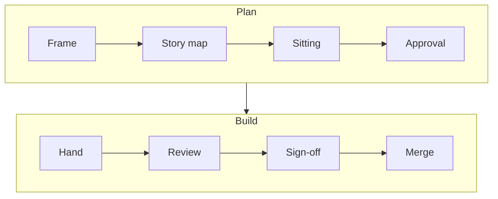

# deckhand

[](https://github.com/JSA-Partners/deckhand/releases)
[](https://github.com/JSA-Partners/deckhand/actions/workflows/ci.yaml)
[](LICENSE)

A feature process for Claude Code: you plan and review, background sessions build, kept in Linear.

deckhand is a [Claude Code](https://code.claude.com/) plugin that runs on
[superpowers](https://github.com/obra/superpowers) and [impeccable](https://impeccable.style).
superpowers does the brainstorming, planning, and implementation, and impeccable the design of
anything a person sees. deckhand adds the process around them: a feature planned with you a screen
at a time, a hand per story that builds in the background, and one captain that brings you what
needs you, one item at a time.

## Table of Contents

- [Background](#background)
- [Install](#install)
- [Usage](#usage)
- [How it is built](#how-it-is-built)
- [Contributing](#contributing)
- [License](#license)

## Background

A feature is one Linear project and one release, planned for a week and never more than two. A story
is one Linear issue inside it, built by a hand: a background Claude Code session in the story's
worktree. Linear moves each story from its pull request, and deckhand writes no status.



| Step | Claude | You, to move it on |
| --- | --- | --- |
| Frame | Shapes the problem with you, then lists the facts it rests on and spikes the unverified ones | Write the frame, or take a draft |
| Story map | Proposes one-line stories and the contract they share | Approve the contract and the invariants |
| Sitting | Asks about each story where it is uncertain, then checks your answers against the code | Answer before you see its view |
| Approval | Reviews the stories against each other | Approve the feature |
| Hand | Writes the implementation plan and builds it with tests | Answer its questions |
| Review | Reviews the plan and the branch in rounds, ordered by confidence | Decide what a hand cannot |
| Sign-off | Shows what changed, the evidence, a targeted tuicr pass and a quiz | Sign off |
| Merge | Merges pinned to the commit you signed, then does the after-merge chores it can | Do the ones it leaves you |

You talk only to the captain. While you are away, hands keep working up to your slot cap; a hand
that stops wakes the captain, which only updates a count. On your return it says how many items
wait and shows the top one. Every answer is saved as it is given, so you can stop after any item.

Hands run in Claude Code's sandbox. A hand cannot read credentials (deckhand's config, `gh`, ssh,
git), cannot push or write to GitHub except through deckhand, cannot forge your answers,
cannot write `.git` or Claude Code's settings, and runs without MCP tools or messaging. A change it
wants to Claude Code's own config reaches you as a queue item. One gap is deliberate:
`checks apply` runs a hand's tests, and any check command a hand adds to `.claude/deckhand.toml`,
with deckhand's access.

## Install

### Dependencies

- [Claude Code](https://code.claude.com/) with [superpowers](https://github.com/obra/superpowers) and
  [impeccable](https://impeccable.style)
- [uv](https://docs.astral.sh/uv/), git, and [`gh`](https://cli.github.com/), authenticated
- A paid Linear workspace with the GitHub integration installed for each repository
- A Linear OAuth app with client credentials, and your personal API key
- [tuicr](https://github.com/agavra/tuicr), for your pass over the branch at sign-off

deckhand works with Linear and GitHub only.

### Plugins

```bash
claude plugin marketplace add obra/superpowers
claude plugin install superpowers@superpowers-dev
claude plugin marketplace add pbakaus/impeccable
claude plugin install impeccable@impeccable
claude plugin marketplace add JSA-Partners/deckhand
claude plugin install deckhand@jsapartners
```

### Credentials

Both files live in `~/.config/deckhand/`, readable by you alone (`chmod 600`):

- `linear-app.json`: the app's `client_id` and `client_secret`, for every write a hand causes
- `linear-personal.key`: your personal API key, for your decisions and new features

### Updating

```bash
claude plugin update deckhand@jsapartners
```

Then restart every running Claude Code session, because a session keeps the version it started
with.

## Usage

These are slash commands, typed in a Claude Code session in one of your repositories.

| Command | What it does |
| --- | --- |
| `/deckhand:setup KEY` | Fits Linear team KEY to the process, names its repositories and clones, and prints the captain's launch line |
| `/deckhand:captain` | Starts hands, and brings you the queue one item at a time |
| `/deckhand:feature` | Opens, picks or parks a feature, and plans it with you a screen at a time |
| `/deckhand:signoff REF` | Walks you through story REF's sign-off, one screen at a time |
| `/deckhand:commit` | Writes a conventional commit for the staged changes |
| `/deckhand:document` | Records what a branch taught in `docs/claude/` |

Run setup once per machine, and again when a repository joins. Then launch the captain with the line
it prints, which starts Claude Code under the captain's own settings. The captain runs the feature
and sign-off skills for you when an item needs them. Hands run `story`, `spike` and `draft` on
their own; you never type those.

## How it is built

deckhand is largely written by Claude Code. Every design is worked out with a human in a brainstorm
and a plan, and every change is read by hand before it is committed. It runs daily on real product
work, and what trips it up there becomes the next release.

## Contributing

Questions and bug reports go in [issues](https://github.com/JSA-Partners/deckhand/issues), and pull
requests are welcome. See [CONTRIBUTING.md](CONTRIBUTING.md) for the development setup and the
commit rules.

## License

[MIT](LICENSE). Built by [JSA+Partners](https://jsapartners.co).
