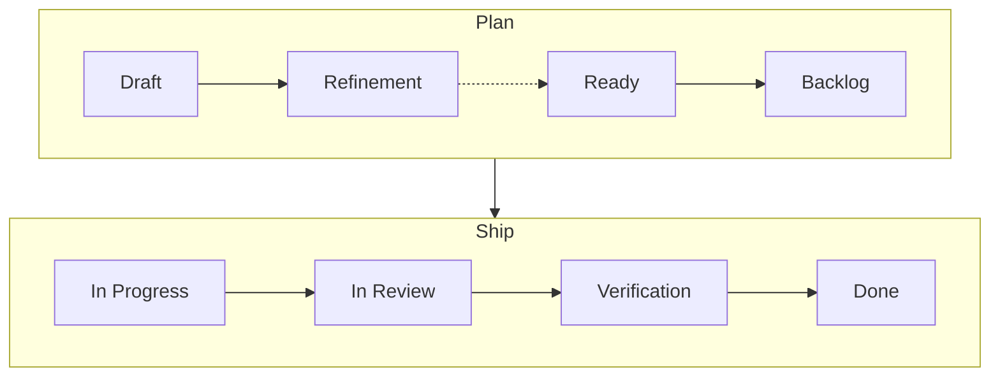

# deckhand

[](https://github.com/JSA-Partners/deckhand/releases)
[](https://github.com/JSA-Partners/deckhand/actions/workflows/ci.yaml)
[](LICENSE)

A story process for Claude Code: from feature request to merged pull request, kept in GitHub issues.

deckhand is a [Claude Code](https://code.claude.com/) plugin that runs on
[superpowers](https://github.com/obra/superpowers). superpowers does the brainstorming, planning,
and implementation. deckhand adds the process around it: one issue per story, a review you settle in
conversation, a board that follows the work, and a pull request that opens only from a commit you
have read.

## Table of Contents

- [Background](#background)
- [Install](#install)
- [Usage](#usage)
- [How it is built](#how-it-is-built)
- [Contributing](#contributing)
- [License](#license)

## Background

A story is one GitHub issue, written by Claude and frozen once the build starts. Its comments are the
log, one entry per decision. The story sits on a GitHub Project board and moves through its columns
as the work does.



`/deckhand:new` starts a story in Refinement, and `--park` leaves it in Draft. Each solid arrow is
your decision. The dashed one happens on its own.

| Column | Claude | You, to move it on |
| --- | --- | --- |
| Draft | Holds a parked feature | Write it into a story |
| Refinement | Writes the story, then reviewer and skeptic read it | Nothing |
| Ready | Waits | Choose the kind and points |
| Backlog | Puts it in build order and checks the plan against main | Say build |
| In Progress | Builds in the story's worktree and reviews the branch | Read the branch |
| In Review | Opens the pull request and runs checks | Merge |
| Verification | Waits | Tick the after-the-merge items |

Several sessions can work from one clone, each on its own story in its own worktree. Nothing about a
story is written to the repository, and you never act on GitHub. You open it to read.

## Install

### Dependencies

- [Claude Code](https://code.claude.com/) with [superpowers](https://github.com/obra/superpowers)
- [`gh`](https://cli.github.com/), authenticated with the `project` scope: `gh auth refresh -s project`
- Admin rights on the repository, so setup can make squash the only merge
- Python 3.12 or newer
- [tuicr](https://github.com/agavra/tuicr), for your pass over the branch before the pull request
- A GitHub Project, or setup creates one

deckhand works with GitHub only.

### Plugins

```bash
claude plugin marketplace add obra/superpowers
claude plugin install superpowers@superpowers-dev
claude plugin marketplace add JSA-Partners/deckhand
claude plugin install deckhand@jsapartners
```

### Updating

```bash
claude plugin update deckhand@jsapartners
```

Then restart every running Claude Code session, because a session keeps the version it started
with. Stories in flight are safe, and `/deckhand:captain` says if the board needs setup run again.

## Usage

These are slash commands, typed in a Claude Code session in your repository.

| Command | What it does |
| --- | --- |
| `/deckhand:setup` | Links the repository to a GitHub Project and fixes the board's fields |
| `/deckhand:new "<idea>"` | Turns an idea into a story, or a big idea into several |
| `/deckhand:next N` | Carries story N on to your next decision |
| `/deckhand:captain` | Answers for the whole project and says what to run next |
| `/deckhand:commit` | Writes a conventional commit for the staged changes |
| `/deckhand:document` | Records what a branch taught in `docs/claude/` |

Run setup once per repository, and again until it says setup is complete. It tells you what the
GitHub API cannot do and where to click.

### Stories

`new` is a conversation sized to the idea: a question or two for a fix, a whole brainstorm for a
feature. A big idea comes out as several stories, blocked on each other where one needs another
first, across repositories when the work spans them.

`next` carries a story to the next decision that is yours and stops there. Run it again, in any
session, and it picks up where the story is.

### The captain

`captain` reads every story and every open Claude Code session on this machine. It opens with the
sessions waiting on you, what moved since you last looked, what to run next, and which pull request
to merge first. After that, ask it anything: what is blocked, what to pick up, or when the board is
likely done. Give it a priority and it plans lanes, one session each, keeping stories that touch the
same files apart. It writes to the board and nowhere else.

### Features

A feature is an option of the project's Feature field, never an issue, so it can span every
repository of the project. The order of the options is the build order: drag them in the project's
settings to change it.

```text
deckhand epic open "Let guests in" --about "A client sees their own collection and nothing else."
deckhand epic add "Let guests in" 261 259 owner/front-end#133
deckhand epic list
deckhand epic forecast "Let guests in"
deckhand epic close "Let guests in"
```

`epic forecast` lists the feature's stories by column and says how many weeks the open ones will
take, likely (85th percentile) and possibly as early as (50th). It simulates from how many of the
feature's stories finished each week, the method of Daniel Vacanti's "When Will It Be Done?", and
weeks the whole board stalled do not set the pace. With too little history it says so.

## How it is built

deckhand is largely written by Claude Code. Every design is worked out with a human in a brainstorm
and a plan, and every change is read by hand before it is committed. It runs daily on real product
work, and what trips it up there becomes the next release.

## Contributing

Questions and bug reports go in [issues](https://github.com/JSA-Partners/deckhand/issues), and pull
requests are welcome. See [CONTRIBUTING.md](CONTRIBUTING.md) for the development setup and the
commit rules.

## License

[MIT](LICENSE). Built by [JSA+Partners](https://jsapartners.co).
